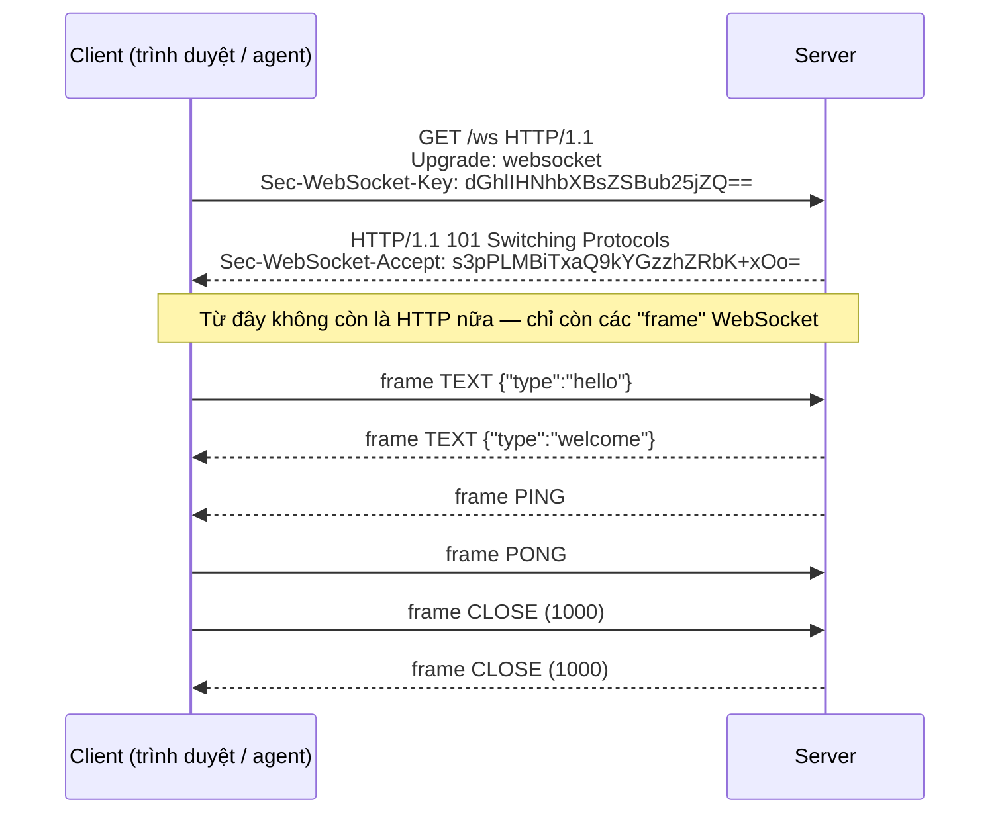

# 01. WebSocket

> Mục tiêu: hiểu WebSocket là gì, hoạt động ra sao ở mức giao thức, khi nào dùng và các lỗi hay gặp.
> Code minh họa: [`demos/01-websocket-chat`](../demos/01-websocket-chat) và [`ws_lite.py`](../demos/01-websocket-chat/lib/ws_lite.py).

## 1. Vấn đề WebSocket giải quyết

HTTP truyền thống là **request → response**: chỉ client mới được "mở lời". Muốn server chủ động báo tin (giá chứng khoán, tin nhắn chat, CPU vừa tăng vọt...) thì trước đây phải dùng mẹo:

| Kỹ thuật | Cách làm | Nhược điểm |
|---|---|---|
| Short polling | Client hỏi mỗi N giây | Tốn request vô ích, độ trễ tối đa = N giây |
| Long polling | Server giữ request đến khi có dữ liệu | Mỗi tin = 1 request mới, header HTTP lặp lại |
| SSE (Server-Sent Events) | Server đẩy một chiều qua HTTP | Chỉ server → client |

**WebSocket** (RFC 6455, 2011) mở **một kết nối TCP lâu dài, hai chiều (full-duplex)**: cả client lẫn server đều có thể gửi bất cứ lúc nào, mỗi message chỉ tốn 2–14 byte header thay vì vài trăm byte header HTTP.

## 2. Vòng đời một kết nối



### 2.1 Handshake
1. Client gửi request HTTP bình thường kèm `Upgrade: websocket` và một khóa ngẫu nhiên `Sec-WebSocket-Key`.
2. Server tính `Sec-WebSocket-Accept = base64( SHA1( key + "258EAFA5-E914-47DA-95CA-C5AB0DC85B11" ) )` và trả **101 Switching Protocols**.
3. Kết nối TCP được giữ nguyên và chuyển sang giao thức WebSocket.

→ Vì bắt đầu bằng HTTP nên WebSocket đi qua được port 80/443, proxy, load balancer (nếu chúng hỗ trợ header `Upgrade`).

### 2.2 Cấu trúc frame

```
 0               1               2               3
 0 1 2 3 4 5 6 7 0 1 2 3 4 5 6 7 0 1 2 3 4 5 6 7 0 1 2 3 4 5 6 7
+-+-+-+-+-------+-+-------------+-------------------------------+
|F|R|R|R| opcode|M| Payload len |    Extended payload length    |
|I|S|S|S|  (4)  |A|     (7)     |            (16/64)            |
|N|V|V|V|       |S|             |                               |
+-+-+-+-+-------+-+-------------+ - - - - - - - - - - - - - - - +
|     Masking-key (32 bit, chỉ có khi MASK = 1)   |   Payload... |
+-------------------------------------------------+--------------+
```

| Trường | Ý nghĩa |
|---|---|
| FIN | 1 = frame cuối của message (message lớn có thể chia nhiều frame) |
| opcode | `0x1` text, `0x2` binary, `0x8` close, `0x9` ping, `0xA` pong, `0x0` frame tiếp nối |
| MASK | Client → server **bắt buộc** mask (chống cache poisoning ở proxy); server → client không mask |
| Payload len | ≤125: độ dài thật; 126: đọc thêm 16 bit; 127: đọc thêm 64 bit |

Trong project, `ws_lite.py` tự cài đặt đúng các bước trên (~200 dòng Python, chỉ dùng `asyncio`) để thấy WebSocket "không có gì thần bí". Khi làm thật nên dùng thư viện như `websockets`, FastAPI/Starlette, `python-socketio`.

### 2.3 Heartbeat (ping/pong)
Khi client rút dây mạng, TCP **không** báo ngay cho server → server vẫn tưởng client còn sống ("half-open connection"). Giải pháp: server ping định kỳ, không nhận pong thì hủy kết nối. Xem hàm `heartbeat()` trong `ws_lite.py`.

## 3. Các vấn đề thực tế khi đưa vào hệ thống

| Vấn đề | Cách xử lý trong project |
|---|---|
| Rớt mạng, server restart | Client tự kết nối lại với **exponential backoff + jitter** (`agent.py`, dashboard) |
| Mất dữ liệu khi đang mất kết nối | Agent **đệm** tối đa 100 mẫu rồi gửi bù |
| Xác thực | Kiểm tra token **trước** khi trả 101 (`verify` trong route `/ws/agent`) |
| Định dạng message | Thống nhất "phong bì" JSON `{ type, ts, data }` |
| Client gửi dữ liệu quá lớn | Giới hạn payload 1 MB, vượt thì đóng với mã 1009 |
| Scale nhiều server | Kết nối là *stateful* → cần sticky session hoặc pub/sub (Redis) để broadcast giữa các instance |
| Bảo mật đường truyền | Production dùng `wss://` (WebSocket over TLS) |

## 4. Khi nào nên / không nên dùng

**Nên:** chat, dashboard giám sát realtime, game online, collaborative editing, bảng giá, thông báo tức thì.

**Không cần:** dữ liệu ít thay đổi (dùng REST + cache), chỉ cần server → client một chiều (SSE đơn giản hơn), giao tiếp giữa 2 hệ thống backend theo sự kiện thưa thớt (dùng **webhook**).

## 5. Câu hỏi tự kiểm tra
1. Tại sao WebSocket bắt đầu bằng một request HTTP?
2. Vì sao client phải mask dữ liệu còn server thì không?
3. Nếu có 3 instance hub phía sau load balancer, agent kết nối vào instance A, dashboard kết nối vào instance B — dashboard có thấy metric không? Sửa thế nào?
4. Khác biệt giữa `close` do server chủ động và mất kết nối do rớt mạng — phát hiện mỗi loại thế nào?

## Tài liệu tham khảo
- RFC 6455 — The WebSocket Protocol: https://datatracker.ietf.org/doc/html/rfc6455
- MDN — WebSocket API: https://developer.mozilla.org/en-US/docs/Web/API/WebSockets_API
- Thư viện Python `websockets`: https://websockets.readthedocs.io/
- FastAPI WebSockets: https://fastapi.tiangolo.com/advanced/websockets/
