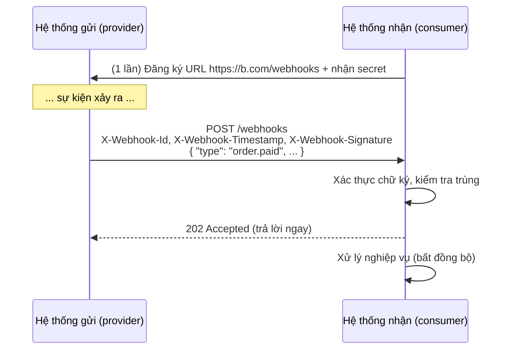

# 02. Webhook

> Mục tiêu: hiểu webhook là gì, cách gửi/nhận an toàn và tin cậy.
> Code minh họa: [`demos/02-webhook-hmac`](../demos/02-webhook-hmac).

## 1. Webhook là gì?

Webhook là **"HTTP callback"**: khi có sự kiện xảy ra, hệ thống A **chủ động gửi một HTTP POST** tới một URL mà hệ thống B đã đăng ký trước.

> Ví dụ đời thường: thay vì cứ 5 phút gọi điện hỏi shipper "hàng tới chưa?" (polling), bạn để lại số điện thoại để shipper **gọi khi tới nơi** (webhook).

Ví dụ thực tế: GitHub gửi webhook khi có push; Stripe/VNPay/MoMo gửi khi thanh toán thành công; Discord/Slack/Telegram **nhận** webhook để hiện tin nhắn vào kênh chat.



## 2. So với WebSocket

| | WebSocket | Webhook |
|---|---|---|
| Kết nối | Lâu dài, giữ liên tục | Mỗi sự kiện 1 request HTTP rồi đóng |
| Chiều | 2 chiều | 1 chiều (A → B) |
| Ai với ai | Thường client ↔ server | **Server ↔ server** |
| Bên nhận cần | Không cần public URL (client chủ động kết nối) | **Phải có URL public** để bên gửi gọi tới |
| Hợp với | Dữ liệu liên tục, tần suất cao | Sự kiện rời rạc, tần suất thấp |

## 3. Bốn nguyên tắc khi NHẬN webhook

### 3.1 Xác thực chữ ký (authenticity)
URL webhook là public — ai cũng có thể POST vào. Bên gửi dùng **secret chung** để ký:

```
signature = "sha256=" + HMAC_SHA256(secret, timestamp + "." + rawBody)
```

Bên nhận tính lại và so sánh bằng `hmac.compare_digest` (tránh *timing attack*). **Lưu ý:** phải ký/xác thực trên **raw body**; nếu `json.loads` rồi `json.dumps` lại thì thứ tự key/khoảng trắng có thể khác → chữ ký sai.

### 3.2 Chống replay
Kẻ tấn công bắt được 1 request hợp lệ và gửi lại sau. Vì timestamp nằm trong phần được ký, bên nhận chỉ chấp nhận request có timestamp lệch ≤ 5 phút.

### 3.3 Idempotency (xử lý trùng)
Webhook thường được đảm bảo **"at-least-once"** — có thể đến **nhiều lần** (bên gửi retry vì timeout dù bên nhận đã xử lý xong). Mỗi sự kiện có `X-Webhook-Id` duy nhất; bên nhận lưu id đã xử lý và bỏ qua bản trùng. Không làm điều này → khách bị cộng tiền 2 lần!

### 3.4 Trả lời nhanh, xử lý sau
Bên gửi thường timeout sau 5–10 giây. Bên nhận nên: xác thực → lưu vào hàng đợi → trả `2xx` ngay → worker xử lý sau.

## 4. Ba nguyên tắc khi GỬI webhook

| Nguyên tắc | Chi tiết | Trong demo 02 |
|---|---|---|
| Retry có backoff | Lỗi mạng/5xx/429 → thử lại sau 1s, 2s, 4s, 8s... + jitter ngẫu nhiên | `send_with_retry()` trong `sender.py` |
| Không retry lỗi 4xx | 400/401/404 gửi lại vẫn sai | `send_with_retry()` |
| Timeout | Không chờ vô hạn bên nhận chậm | `urlopen(..., timeout=5)` |
| Dead Letter Queue | Hết số lần thử → lưu lại để xử lý tay / gửi lại sau | (hướng mở rộng) |
| Fan-out song song | 1 sự kiện → nhiều kênh, kênh này lỗi không ảnh hưởng kênh kia | (sẽ làm ở hệ thống chính) |

## 5. Webhook của các nền tảng chat dùng trong project

| Nền tảng | Endpoint | Body tối thiểu |
|---|---|---|
| Discord | `https://discord.com/api/webhooks/{id}/{token}` | `{ "content": "..."}` hoặc `{ "embeds": [...] }` |
| Slack | `https://hooks.slack.com/services/...` | `{ "text": "..." }` |
| Telegram | `https://api.telegram.org/bot{token}/sendMessage` | `{ "chat_id": ..., "text": "..." }` |

Mỗi kênh có format riêng → hệ thống chính sẽ tách mỗi kênh thành 1 "adapter" riêng. Thêm kênh mới (Email, Microsoft Teams, Zalo OA...) chỉ cần thêm 1 adapter, không sửa phần còn lại.

## 6. Test webhook khi phát triển
- Dùng `mock-receiver` có sẵn trong project (chạy offline).
- https://webhook.site — xem request gửi đến một URL tạm.
- `ngrok` / `cloudflared tunnel` — mở URL public trỏ về máy local để nhận webhook thật từ GitHub, Stripe...

## 7. Câu hỏi tự kiểm tra
1. Tại sao không thể chỉ kiểm tra IP nguồn thay cho chữ ký HMAC?
2. Bên nhận trả `202` rồi bị crash trước khi xử lý xong — sự kiện có mất không? Thiết kế lại thế nào?
3. Vì sao cần jitter trong backoff?
4. Một webhook đến 2 lần, lần 2 đến **trước** lần 1 xử lý xong — idempotency bằng `Set` trong RAM có còn đúng không?

## Tài liệu tham khảo
- GitHub — Validating webhook deliveries: https://docs.github.com/en/webhooks/using-webhooks/validating-webhook-deliveries
- Stripe — Webhooks best practices: https://docs.stripe.com/webhooks
- Standard Webhooks spec: https://www.standardwebhooks.com/
